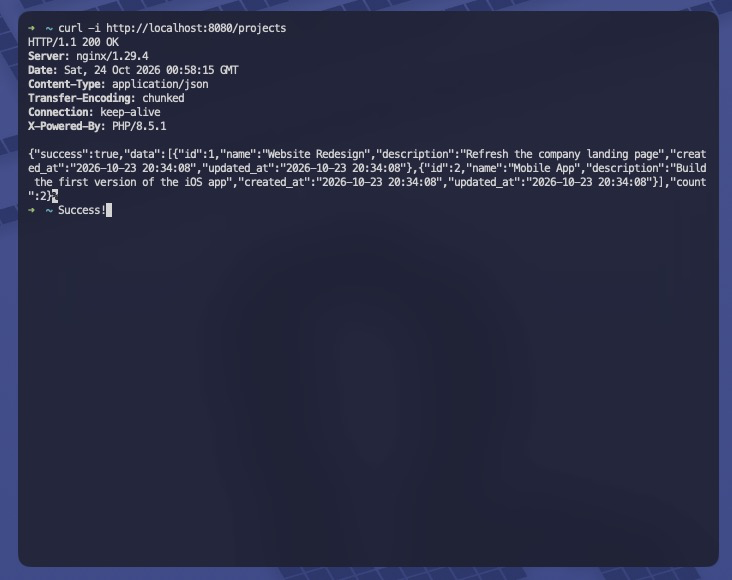

# NGINX Deployment
### Project 1

Student: Sam Stoeckel

---

## Step 1: Install

macOS:

```bash
brew install nginx php mysql
```

Ubuntu / WSL:

```bash
sudo apt update
sudo apt install nginx php-fpm php-mysql mysql-server
```

Check the versions: `nginx -v` and `php -v`

---

## Step 2: Start the Services

macOS:

```bash
brew services start nginx
brew services start php
brew services start mysql
```

Ubuntu / WSL (change `8.3` to your PHP version):

```bash
sudo systemctl restart php8.3-fpm
sudo systemctl restart nginx
```

---

## Check the Services Are Running

macOS: PHP-FPM listens on port 9000

```bash
brew services list
lsof -nP -iTCP:9000 -sTCP:LISTEN
```

Ubuntu / WSL: PHP-FPM uses a socket file

```bash
sudo service nginx status
ls /run/php/
```

---

## Step 3: Find the Config and Web Root

| | macOS | Ubuntu / WSL |
|---|---|---|
| Config | `/opt/homebrew/etc/nginx/nginx.conf` | `/etc/nginx/sites-available/default` |
| Web root | `/opt/homebrew/var/www` | `/var/www/html` |
| Port | 8080 | 80 |

Check the config path with `nginx -t` (`sudo nginx -t` on Ubuntu / WSL).

---

## Step 4: macOS

In `/opt/homebrew/etc/nginx/nginx.conf`, inside `http { }`:

```nginx
server {
    listen 8080;
    server_name localhost;
    root /opt/homebrew/var/www;
    index index.php index.html index.htm;
    location / {
        try_files $uri $uri/ /index.php?$query_string;
    }
    location ~ \.php$ {
        try_files $uri =404;
        fastcgi_pass 127.0.0.1:9000;
        fastcgi_index index.php;
        fastcgi_param SCRIPT_FILENAME $document_root$fastcgi_script_name;
        include fastcgi_params;
    }
}
```

---

## Step 4: Ubuntu / WSL

In `/etc/nginx/sites-available/default`:

```nginx
server {
    listen 80;
    server_name localhost;
    root /var/www/html;
    index index.php index.html index.htm;

    location / {
        try_files $uri $uri/ /index.php?$query_string;
    }

    location ~ \.php$ {
        try_files $uri =404;
        include snippets/fastcgi-php.conf;
        fastcgi_pass unix:/run/php/php8.3-fpm.sock;
    }
}
```

---

## Step 5: Copy the API Files

macOS:

```bash
cp code/index.php code/handlers.php code/db.php code/auth.php \
   code/test_client.html /opt/homebrew/var/www/
```

Ubuntu / WSL:

```bash
sudo cp code/index.php code/handlers.php code/db.php code/auth.php \
   code/test_client.html /var/www/html/
```

Copy again after any code change.

---

## Step 6: Set Up the Database

Open MySQL as root: `mysql -u root` (macOS) or `sudo mysql` (Ubuntu / WSL)

```sql
CREATE DATABASE IF NOT EXISTS project_tracker;
CREATE USER IF NOT EXISTS 'ase230'@'localhost' IDENTIFIED BY 'ase230pass';
GRANT SELECT, INSERT, UPDATE, DELETE ON project_tracker.* TO 'ase230'@'localhost';
```

Load the tables. macOS:

```bash
mysql -u root project_tracker < code/schema.sql
```

Ubuntu / WSL:

```bash
sudo mysql project_tracker < code/schema.sql
```

---

## Step 7: Test and Reload

macOS:

```bash
nginx -t
nginx -s reload
```

Ubuntu / WSL:

```bash
sudo nginx -t
sudo service nginx reload
```

Always run the test first. A broken config will not load.

---

## Step 8: Check It Works

macOS (port 8080):

```bash
curl -i http://localhost:8080/projects
BASE_URL=http://localhost:8080 bash code/test_curl.sh
```

Ubuntu / WSL (port 80):

```bash
curl -i http://localhost/projects
BASE_URL=http://localhost bash code/test_curl.sh
```

---

## Screen Capture



---

## References

ASE 230 Module 1, `5_Webserver_using_NGINX`

- *1. Introduction and Installation of NGINX.pdf*: commands pp. 16–17, file locations pp. 18–22, port check pp. 25–26
- *2. Setting up NGINX for PHP.pdf*: architecture p. 5, PHP-FPM pp. 9–10, server block pp. 11–12, port 9000 p. 13, web root p. 14, Linux pp. 15–18, reload p. 28
- *3. Advanced NGINX Configuration (Optional).pdf*: `index.php` fallback p. 9
- Code: `module1/code/5_Webserver_using_NGINX/nginx_mac.conf` and `nginx.conf`
